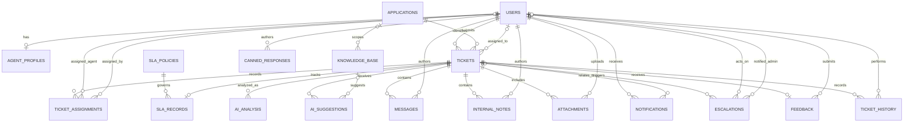

# SmartSLA database

The PostgreSQL schema is defined in `schema.prisma`. The initial migration is
in `migrations/20261125193000_init/`; it creates the schema and adds database
checks for valid ratings, confidence scores, SLA durations, workload capacity,
and escalation levels. The migration is the source of truth for those checks,
because Prisma Schema Language does not model SQL `CHECK` constraints.

## Entity relationship diagram



## Tables and relationships

| Table | Purpose and key relationships |
| --- | --- |
| `users` | Customers, agents, and admins; `account_status` is the active/inactive flag. |
| `applications` | Normalized application catalog. Tickets and optional knowledge entries reference it. |
| `agent_profiles` | One-to-one agent skills, availability, team, and positive workload capacity. |
| `tickets` | Complaint, application/customer/assigned-agent links, priority, lifecycle status, and resolution timestamps. |
| `ticket_assignments` | Assignment history with type, reason, assigner, and end time. |
| `sla_policies` | One policy per priority with first-response, resolution, and warning durations. |
| `sla_records` | One current SLA record per ticket; response and resolution state are tracked separately. |
| `knowledge_base` | Application/category troubleshooting content with approval and soft-deactivation flags. |
| `ai_analysis` | Versioned AI category, priority, confidence, sentiment, and duplicate analysis. |
| `ai_suggestions` | Suggested resolution and optional knowledge-base source, plus customer response. |
| `messages` | Public ticket conversation, including an optional attachment URL. |
| `internal_notes` | Private staff-only ticket notes. |
| `attachments` | Uploaded file metadata and storage key; file bytes are stored outside PostgreSQL. |
| `canned_responses` | Reusable staff response templates. |
| `notifications` | User notifications with title, read state, and optional ticket link. |
| `escalations` | SLA/manual escalation, recommendation, action, status, and notified admin. |
| `feedback` | One CSAT response per ticket, rated from 1 through 5. |
| `ticket_history` | Ticket audit events, optional old/new JSON values, and public/private visibility. |

Database names use `snake_case`; Prisma's generated client uses the mapped
camelCase fields. Foreign-key delete behavior is defined in the Prisma schema.
Knowledge entries are deactivated rather than deleted so past suggestions can
retain their source.

## Create and seed a local database

From `backend/`, with PostgreSQL available and `DATABASE_URL` set:

```powershell
npm run db:generate
npm run db:migrate
npm run db:seed
```

The seed is synthetic and creates 12 applications, 15 approved knowledge
entries, 30 sample tickets, and related demo analyses, assignments, SLA
records, escalations, notifications, conversations, and feedback. Existing
sample tickets are not duplicated on reruns. See [backend setup](../README.md)
for local accounts and service startup.
